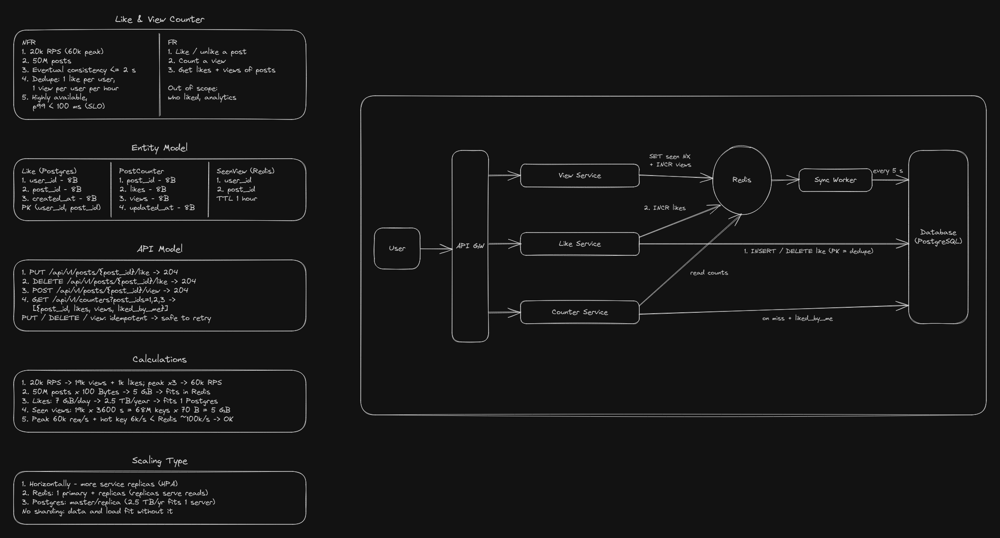
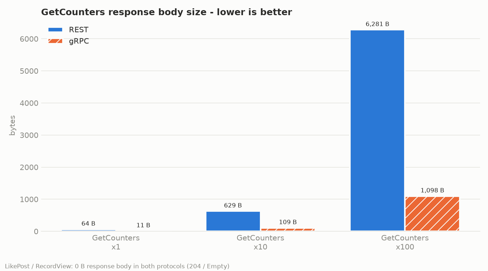
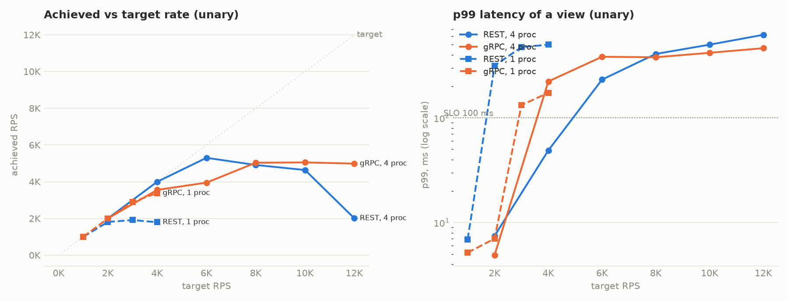
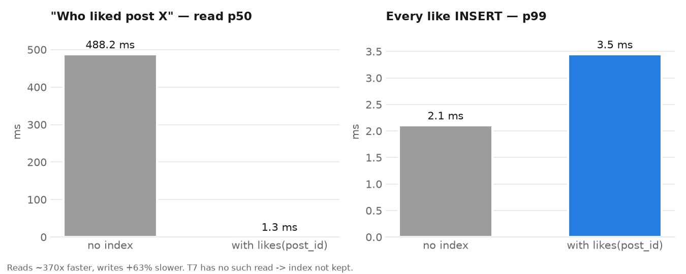
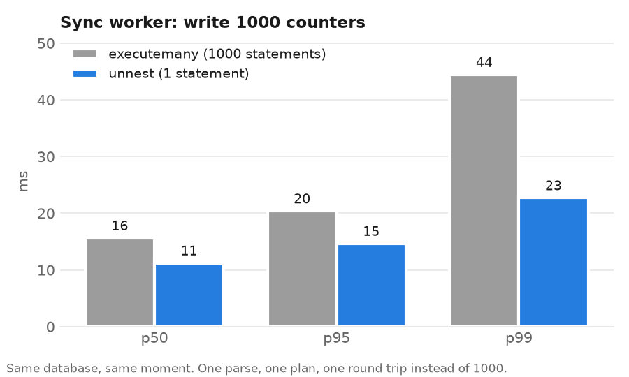
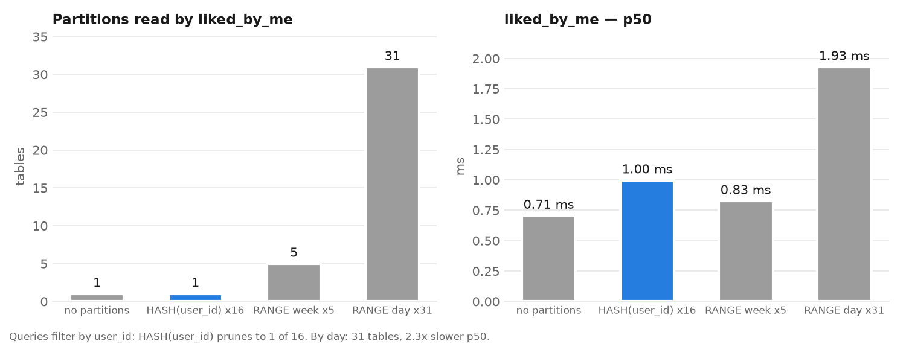
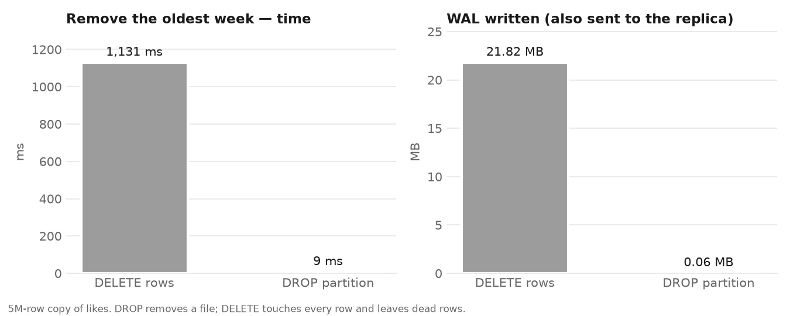
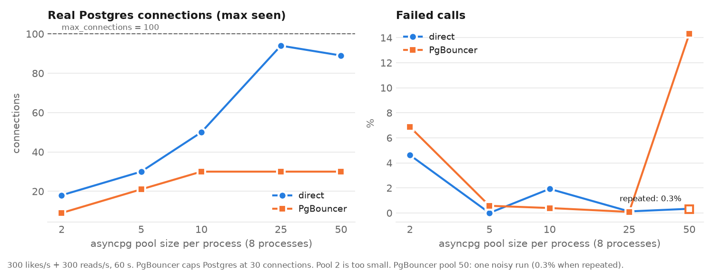
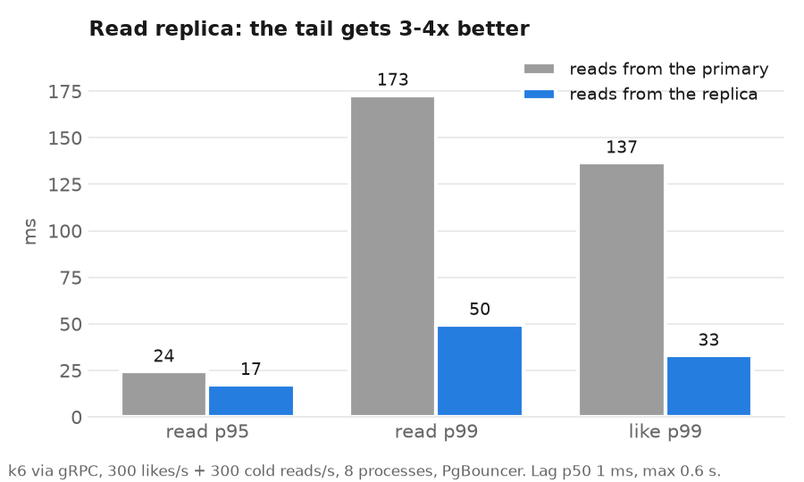

# T7 Like & View Counter: SIS #2 and SIS #3

A walkthrough of what was built, the measured results, and the reasons behind them.
Full reports: [README.md](README.md) (SIS #2), [SIS3.md](SIS3.md) (SIS #3). Raw numbers: [benchmark/](benchmark/).

---

## 1. The task

| | Requirement |
|---|---|
| Load | **~20,000 increments/s** (likes + views) |
| Data | **50M posts**, 20M likes |
| Consistency | eventual, a new count visible **≤ 2 s** |
| SIS #2 | protocol choice (gRPC vs REST), idempotency, timeouts, retries, measurements |
| SIS #3 | schema + indexes, EXPLAIN ANALYZE, partitioning, read replica, connection pooling, before/after p95/p99 |

## 2. Architecture



- Every +1 goes to **Redis** (one Lua script = one round trip, atomic).
- Reads come from **Redis**, so a new count is visible at once (measured lag p99 **15 ms**).
- The **sync worker** copies changed posts (`dirty_posts`) to **Postgres** every 5 s in one `unnest` statement.
- Postgres sits behind **PgBouncer**. Cold reads go to a **streaming replica**.
- One core logic ([app/core/](app/core/)) behind two doors: **REST** (FastAPI) and **gRPC**.

---

# SIS #2: protocol and reliability

## 3. Why gRPC (inside the system)



- Protobuf: GetCounters for 100 posts **6,281 B JSON vs 1,098 B** (5.7× smaller); a batch of 100 views 3.2× smaller.
- HTTP/2 multiplexing, a strict `.proto` contract, built-in deadlines and retries.
- REST/JSON stays at the edge (browsers, mobile).

## 4. Idempotency, timeouts, retries

| Operation | Why a retry is safe |
|---|---|
| Like (`PUT` / `LikePost`) | PK `(user_id, post_id)` + `ON CONFLICT DO NOTHING` → second call inserts 0 rows |
| View (`POST` / `RecordView`) | `SET seen:{u}:{p} NX EX 3600` → second call within 1 h is a no-op |
| Batch views | the same `SET NX` per view |
| Read | read-only |

- Client deadline **0.5 s** (retries included); server → Postgres/Redis **200 ms** → `503` / `UNAVAILABLE`.
- At most 3 attempts, only on "try again" codes, **exponential backoff with full jitter**.
- 59 tests: every reliability test runs for **both** REST and gRPC (`pytest -v`).

## 5. 20,000 increments/s



| Protocol | target | achieved | failed | p99 | consistency lag p99 |
|---|---:|---:|---:|---:|---:|
| gRPC | 20,000 | **20,001** | **0** | **12.9 ms** | 15 ms |
| REST | 20,000 | 20,001 | 0 | 12.3 ms | 18 ms |
| gRPC | 40,000 | 39,780 | 0 | **105 ms** | 137 ms |
| REST | 40,000 | 39,734 | 1 | 196 ms | 249 ms |

How: **Lua scripts** (3 Redis calls → 1), **4 processes** per server (the GIL = 1 core per process),
**batching** (`RecordViews`, 100 views per call). k6 with a **fixed arrival rate** (open model),
so queueing shows up in the tail. At 40K, gRPC has about half the p99 of REST.
Details: [benchmark/load_results.md](benchmark/load_results.md).

---

# SIS #3: the database

**Method:** every change is measured before and after: `EXPLAIN (ANALYZE, BUFFERS)` for single
queries ([db/explain.sql](db/explain.sql)), Python benchmarks for SQL, k6 through the real API.
A change that did not help is reported too.

## 6. Schema and indexes: every query hits a primary key

| Query | Index (from EXPLAIN) |
|---|---|
| like / unlike | `likes` PK `(user_id, post_id)` |
| cold read | `post_counters` PK `(post_id)` |
| `liked_by_me` | `likes` PK, **Index Only Scan** |
| sync upsert | `post_counters` PK (`ON CONFLICT`) |

**The extra index is a trade-off, decided by numbers:**



`likes(post_id)` makes "who liked post X" **~370× faster**, but every like INSERT **+63% p99**
and −9% throughput, +304 MB. T7 never asks that question → not kept. Without it, EXPLAIN shows
`Buffers: read=78786`: `post_id` is the **second** key column (leftmost-prefix rule, Lecture 6).

## 7. Sync worker: one statement instead of 1000



`INSERT ... SELECT FROM unnest($1, $2, $3) ON CONFLICT DO UPDATE`: p99 **44 → 23 ms**, +45% rows/s.
Plus `fillfactor = 80` (HOT updates), `synchronous_commit = off` (the table is a copy), sorted ids (no deadlocks).

## 8. Partitioning: HASH(user_id) × 16



Every query on `likes` has `user_id = $1` → partition pruning reads **1 of 16** (EXPLAIN:
`Index Only Scan using likes_p12_pkey on likes_p12`). By day, the same query reads 31 tables, **2.3× slower**.
The gain is maintenance (VACUUM / reindex per partition), not single-query speed. `post_counters` is not
partitioned: a read of 100 random posts would hit every partition.



For data with a lifetime: `DROP PARTITION` **9 ms vs 1,131 ms** for DELETE (130×), WAL 0.06 vs 21.8 MB.

## 9. Connection pooling: PgBouncer (transaction mode)



- Direct: Postgres connections grow with the pool, **18 → 94**, up to the `max_connections = 100` wall.
- PgBouncer: **30** real connections whatever the app pool, the **same p99** (pool 25: 111 vs 108 ms like p99).
- Pool 2 is too small (5–7% failed). Little's Law: 600 q/s × 10 ms ≈ **6** busy connections needed.
- Bugs found under load: asyncpg's reset doubled the PgBouncer slots per query (**88% → 0.05%** failed after
  the fix); zombie backends fixed with `client_connection_check_interval`.
- PgBouncer limits **connections**, not **database speed**: under 5× overload both setups fail.

## 10. Read replica



Streaming replication; GetCounters' cold reads go to the replica. Read p99 **173 → 50 ms**.
Replication lag p50 **1 ms**, max **0.6 s** under overload, below the 2 s requirement. Reads before an
increment stay on the primary (a stale base + 1 would be written back).

## 11. What did not help (honest results)

- **Config tuning** (`shared_buffers` 128 → 384 MB, SSD planner settings): no gain. The data is 5.8 GB
  and the Docker VM has 4 GB RAM.
- **HOT updates fell 99% → 65%** because of `hot_standby_feedback = on` on the replica; `off` would suit T7 better.
- **Watermark (`updated_at`) vs flag (`dirty_posts`):** without an index the scan takes 2.3 s; with one, HOT drops to 0%
  and WAL goes up 45% → we keep the flag.

## 12. Lecture 7: the six questions

| Question | Answer |
|---|---|
| Which wall? | connections first (160 > 100), then cold reads; not writes |
| RPO / RTO | likes RPO 0 on the primary; Redis ≤ 1 s (AOF everysec); manual failover (minutes) |
| Which reads tolerate lag? | GetCounters → replica; reads before a write → primary |
| Is lag monitored? | measured, visible in `pg_stat_replication`; automatic re-routing is a next step |
| Does the key prune? | yes, 1 of 16 partitions |
| pods × pool fit? | with PgBouncer: ≤ 40 server connections per database |

## 13. Limits

Everything runs on **one laptop** (M2, Docker VM 8 CPU / 4 GB): k6, both APIs, Redis, PgBouncer and
**two** Postgres share the same cores and disk. p99 varies between runs, so only trends that repeat are trusted.
The 20K result depends on the laptop's state (power, temperature).

## 14. Live demo

Step-by-step commands (RU): [LIVE_DEMO_RU.md](LIVE_DEMO_RU.md). Short version:

```bash
export COMPOSE_FILE=docker-compose.yml:docker-compose.db.yml
docker compose up -d --wait
curl -X PUT localhost:8000/api/v1/posts/5/like -H "X-User-Id: 1"     # twice → +1 once
curl "localhost:8000/api/v1/counters?post_ids=5" -H "X-User-Id: 1"
pytest -v                                                              # 59 passed
docker compose exec -T postgres psql -U postgres -d counters -f - < db/explain.sql
```
Grafana: http://localhost:3000/d/t7-counter · Swagger: http://localhost:8000/docs

Charts are regenerated from the JSON results with `python -m benchmark.charts_sis3`.
