# T7 Like & View Counter — SIS #2 (protocol) and SIS #3 (database tuning)

Course: Backend for Highloaded Environment.

> **SIS #3 (database tuning)** is in **[SIS3.md](SIS3.md)**: schema and indexes, EXPLAIN ANALYZE,
> partitioning, PgBouncer, read replica, before / after with p95 / p99. This README is SIS #2.

**The task:** implement the service interface with the protocol from SIS #1 (we chose **gRPC**),
with idempotency, timeouts and retries, and measure latency and payload size against a
REST/JSON baseline.

**The load from SIS #1:** ~20,000 increments/s (likes + views), 50M posts, eventual consistency ≤ 2 s.

**Short answer:**

- **20K increments/s: done.** 20,001 increments/s for 60 s, 0 errors, p99 13 ms, a new view is
  visible in a read after 15 ms (p99). How: views are sent in **batches of 100** (`RecordViews`),
  each view is **1 Redis round trip** (a Lua script), and each server runs **4 processes**.
  Details: [benchmark/load_results.md](benchmark/load_results.md), [Part 4](#part-4-20k-incrementss).
- **gRPC vs REST:** Protobuf is **3.2x smaller** for a batch of 100 views and 2.2–5.8x smaller for the
  other calls. At 20K both protocols keep up; at 40K gRPC degrades less (p99 105 ms vs 196 ms).
  For one call at a time, gRPC was 2–2.8x faster at p50 and 8–13x at p99
  ([benchmark/results.md](benchmark/results.md)).

## System design (from SIS #1)

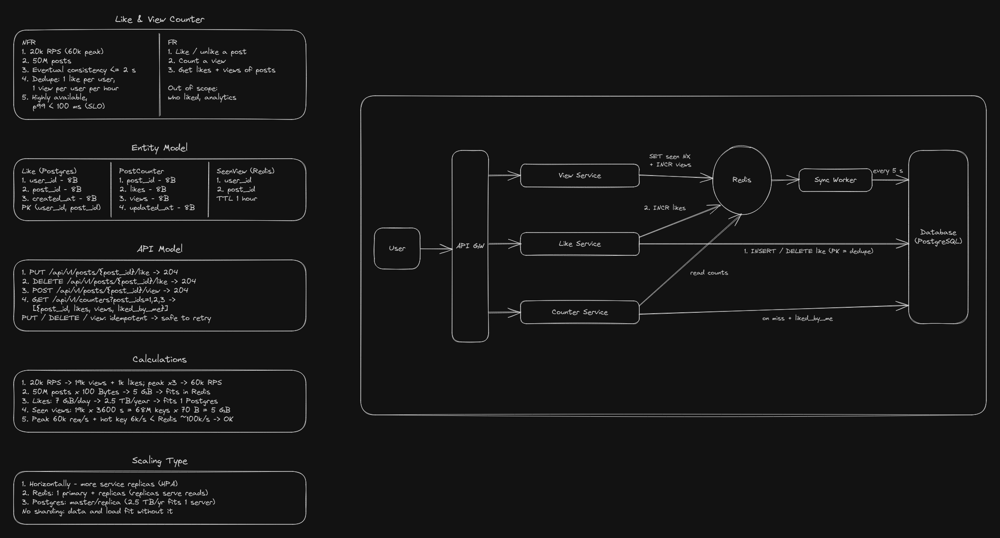

This repo implements this design as one modular service. Like, View and Counter are modules in
`app/core`, called by the REST and gRPC servers. The API Gateway and the replicas are the next
steps for scaling. They are not part of this repo. gRPC is for internal calls. REST/JSON is for
outside clients.

## Contents

1. [How to run](#how-to-run)
2. [How to run the tests](#how-to-run-the-tests)
3. [How to run the benchmark](#how-to-run-the-benchmark)
4. [Monitoring: Prometheus + Grafana](#monitoring-prometheus--grafana)
5. [Project structure](#project-structure)
6. [How it works](#how-it-works) (like, unlike, view, get counters, sync worker)
7. [The parts of the task](#the-parts-of-the-task) (protocol, idempotency + timeouts + retries, measurements, 20K increments/s)

---

## How to run

You need Docker.

```bash
docker compose up --build
```

This starts 7 containers:

| Container | What it does | Port |
|---|---|---|
| `postgres` | Database. Stores likes and a saved copy of the counters. | 5432 |
| `redis` | Live counters in memory. Very fast. | 6379 |
| `rest-api` | REST/JSON API (FastAPI + Uvicorn, 4 processes). Runs the migration first. | 8000 |
| `grpc-api` | gRPC API (grpcio, 4 processes). Uses the **same** code as `rest-api`. | 50051 |
| `sync-worker` | Every 5 s copies counters from Redis to Postgres. | – |
| `prometheus` | Every 5 s reads the metrics of both API servers. | 9090 |
| `grafana` | Shows the metrics as a dashboard. | 3000 |

Try the REST API:

```bash
curl -X PUT  -H "X-User-Id: 1" http://localhost:8000/api/v1/posts/42/like
curl -X POST -H "X-User-Id: 1" http://localhost:8000/api/v1/posts/42/view
curl -H "X-User-Id: 1" "http://localhost:8000/api/v1/counters?post_ids=42,43"
curl -X POST -H "Content-Type: application/json" http://localhost:8000/api/v1/views:batch \
     -d '{"views": [{"user_id": 2, "post_id": 42}, {"user_id": 3, "post_id": 42}]}'
```

**Number of server processes:** `WORKERS=1 docker compose up -d` (default 4). Python runs one
thread of code at a time (the GIL), so one process uses at most one CPU core. More processes =
more cores. REST: `uvicorn --workers N`. gRPC: N processes listen on the same port
(`SO_REUSEPORT`), the Linux kernel gives each new connection to one of them.

API docs in the browser: http://localhost:8000/docs

Try the gRPC API (from the project folder, with the Python packages installed):

```python
import asyncio
from clients.grpc_client import GrpcCounterClient


async def main():
    async with GrpcCounterClient("localhost:50051") as client:
        await client.like_post(user_id=1, post_id=42)
        print(await client.get_counters(user_id=1, post_ids=[42, 43]))


asyncio.run(main())
```

Stop: `docker compose down` (add `-v` to delete the data too).

## How to run the tests

The tests start real Postgres and Redis in Docker (testcontainers). Docker must be running.

```bash
python3.12 -m venv .venv
source .venv/bin/activate
pip install -r requirements.txt
pytest -v          # 59 tests
make lint          # code style: ruff check + ruff format --check
```

| File | What it tests |
|---|---|
| `tests/test_rest.py` | REST: like, unlike, view, get counters, cache miss, cold key, sync worker |
| `tests/test_grpc.py` | gRPC: the same operations, and **REST and gRPC return the same data** |
| `tests/test_reliability.py` | Idempotency, retries, timeouts — **each test runs twice: REST and gRPC** |
| `tests/test_batch.py` | `RecordViews` (batch): counting, duplicates, retry after a lost answer, cold posts — **REST and gRPC** |
| `tests/test_metrics.py` | Both protocols record the Prometheus metrics |

## How to run the benchmark

```bash
docker compose down -v                # delete old data: the benchmark needs a clean database
docker compose up -d --build
docker compose run --rm benchmark     # or: make bench
```

**Always start from a clean database.** The benchmark uses the same user and post ids every time.
On old data, all likes already exist, so LikePost does no real work and looks too fast.

It takes about 2 minutes. It writes 4 files into `benchmark/`:

- `results.csv` — all numbers;
- `results.md` — tables and notes;
- `latency_p50_p99.png` — latency chart;
- `payload_size.png` — payload size chart.

To redraw the charts from `results.csv`: `python -m benchmark.charts`.

The benchmark runs **inside** the Docker network, next to the servers. Why: on a Mac, Docker
Desktop port forwarding made REST (50 TCP connections) 3–4x slower, but not gRPC
(1 connection). That would not be fair.

## Monitoring: Prometheus + Grafana

After `docker compose up`, open the dashboard:

**http://localhost:3000/d/t7-counter** (no login needed to view; admin login: `admin` / `admin`)

It shows 4 panels, updated every 5 s: requests per second, errors per second, p50 latency
and p99 latency, for REST and gRPC. The panels are empty until the API gets some traffic.

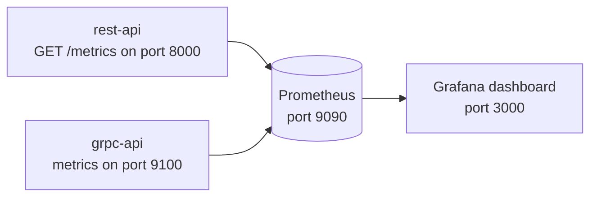

How it works, step by step:

1. Each request goes through `track_request()` in `app/core/metrics.py`. It counts the request
   and measures its time. REST and gRPC use the same function. With several processes, each
   one writes its numbers to files in `PROMETHEUS_MULTIPROC_DIR`, and the metrics page adds
   them up (`render_metrics()`).
2. Each server shows its numbers as a plain text page. REST: `/metrics`. gRPC is not plain HTTP,
   so it has a small separate HTTP server on port 9100.
3. Prometheus reads (scrapes) both pages every 5 s and stores the history.
4. Grafana asks Prometheus for the data and draws the charts. The data source and the dashboard
   are loaded from the `monitoring/` folder on startup, so there is nothing to set up by hand.

The metrics:

| Metric | Type | Meaning |
|---|---|---|
| `counter_requests_total{protocol, operation, status}` | Counter | How many requests finished (`ok` or `error`) |
| `counter_request_duration_seconds{protocol, operation}` | Histogram | How long the server worked on a request |

**Dashboard latency is not benchmark latency.** The dashboard shows time **inside the server**.
The benchmark measures from the client, so it also includes the client library, the network and
waiting in queues. The numbers in `benchmark/results.md` were measured with the metrics turned on.

## Project structure

```
proto/counter.proto        the gRPC contract (methods and messages)
app/
  config.py                all settings, from env vars
  core/                    THE logic. Used by both REST and gRPC.
    resources.py           creates the Postgres pool and Redis client (with timeouts)
    cache.py               Redis: Lua scripts (view, batch of views, +1/-1), cold key, cache miss
    likes.py               like_post, unlike_post
    views.py               record_view, record_views (batch)
    counters.py            get_counters
    errors.py              "backend is slow or down" errors -> 503 / UNAVAILABLE
    faults.py              fault injection for tests (off by default)
    metrics.py             Prometheus metrics, used by both REST and gRPC
  rest/                    REST layer: only translates HTTP/JSON <-> app/core
  grpc_api/                gRPC layer: only translates Protobuf <-> app/core
    generated/             code generated from the .proto file (do not edit)
  worker/                  Sync Worker
clients/                   REST and gRPC clients with deadline + retries
benchmark/                 benchmarks, results, charts
  run_benchmark.py         SIS #2: REST vs gRPC, one call at a time (payload, latency)
  run_load.py              SIS #2: the 20K increments/s load test (runs k6) -> load_results.md
  db_bench.py              SIS #3: the real SQL queries, before / after the tuning
  db_experiments.py        SIS #3: index cost, partitioning, DELETE vs DROP, flag vs watermark
loadtest/                  k6 scripts: increments.js (20K load), db_mix.js (DB-heavy mix)
db/                        SIS #3: seed (50M posts), EXPLAIN script, Postgres config, PgBouncer, replica
monitoring/                Prometheus and Grafana config, the dashboard
tests/                     integration tests
migrations/                Alembic: 0001 creates the tables, 0002 is the SIS #3 tuning
```

**Why the folder is `grpc_api` and not `grpc`:** a folder named `grpc` would hide the
`grpc` library, and `import grpc` would break.

**About `app/grpc_api/generated/`:** these files are made by a tool (`protoc`) from
`proto/counter.proto`. Strange names like `app_dot_grpc__api_dot_generated_dot_counter__pb2`
come from the tool. We never edit these files by hand. After changing the `.proto` file, run:

```bash
make proto
```

## How it works

### Architecture

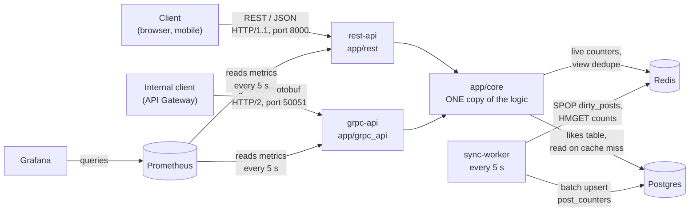

The main idea: **there is only one copy of the logic** (`app/core`). REST and gRPC are thin
"translators" on top of it. So in the benchmark, the only difference is the protocol.

### One request through the layers

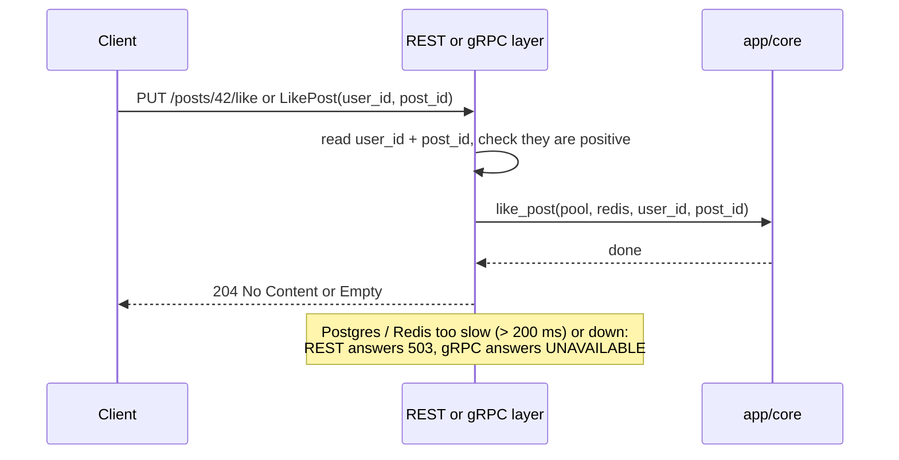

### Where the data lives

- **Postgres `likes(user_id, post_id, created_at)`**: who liked what.
  The primary key `(user_id, post_id)` makes sure one user can like a post only once.
- **Postgres `post_counters(post_id, likes, views, updated_at)`**: a safe copy of the counters on disk.
- **Redis `post:{post_id}`**: a hash `{likes, views}`. The live counter. No TTL.
- **Redis `seen:{user_id}:{post_id}`**: `"1"` with TTL 1 hour. It dedupes views.
- **Redis `dirty_posts`**: a set of posts that changed since the last sync.

Redis persistence: AOF with `fsync` once per second (see `docker-compose.yml`). After a Redis crash
we lose at most ~1 s of counts. RDB snapshots are off: with millions of keys, a snapshot every
~40 s under load caused latency spikes.

### The "cold key" rule

Sometimes `post:{id}` is not in Redis, for example after a Redis restart. If we just add +1,
the counter starts from 0, which is wrong. So before every +1 or −1:

1. Check if `post:{id}` exists in Redis.
2. If not, read the counts from `post_counters` in Postgres.
3. Put them into Redis with `HSETNX`. It writes a field only if it is empty, so it never
   overwrites a newer value.
4. Do the +1.

### One Redis round trip: Lua scripts

Steps "check if it exists" and "+1" (and for a view also the dedupe) run **inside Redis** as one
Lua script ([app/core/cache.py](app/core/cache.py)). One network round trip instead of three, and
Redis runs a script **atomically**: nothing can happen between its steps.

The script returns a code: `1` = counted, `0` = duplicate, `-1` = cold key. On `-1` Python
loads the post from Postgres (rule above) and calls the script again. This is rare: only the
first touch of a post after a Redis restart, or a post nobody touched before.

### Flow 1: Like (`PUT /api/v1/posts/{id}/like`, gRPC `LikePost`)

Code: `like_post()` in `app/core/likes.py`.

1. `INSERT INTO likes ... ON CONFLICT DO NOTHING`.
2. Postgres says how many rows were inserted: `"INSERT 0 1"` or `"INSERT 0 0"`.
3. 0 rows: the user already liked this post. Stop. Nothing changes.
4. 1 row: one Lua script in Redis: if `post:{id}` exists, `HINCRBY likes 1` + `SADD dirty_posts {id}`.
5. The script says "cold": load the post from Postgres (cold key rule), run the script again.

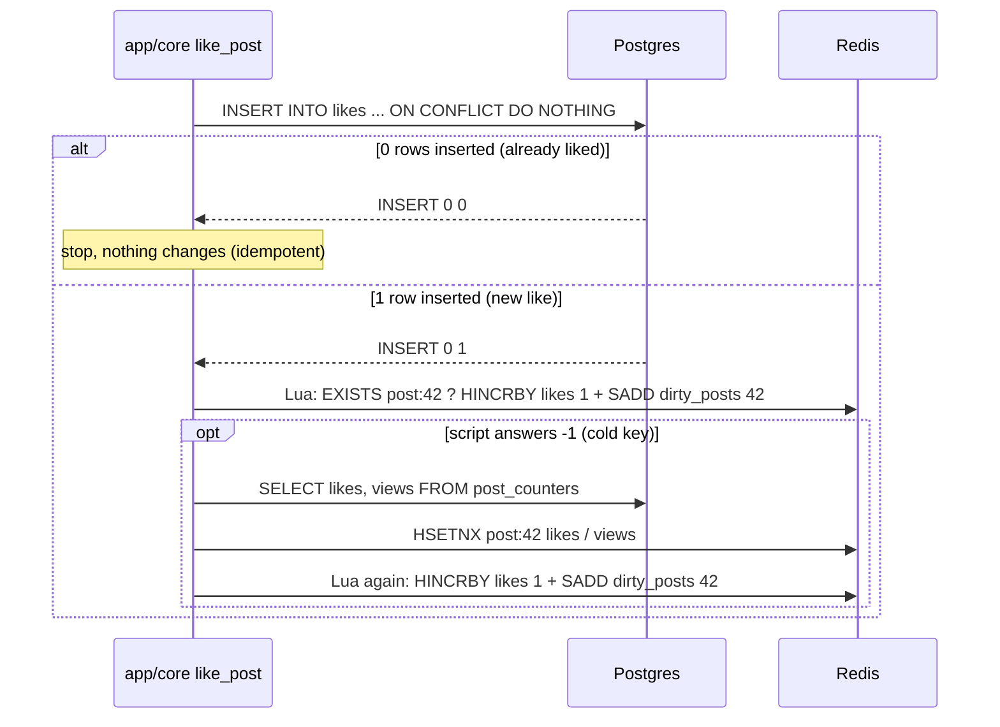

### Flow 2: Unlike (`DELETE /api/v1/posts/{id}/like`, gRPC `UnlikePost`)

Code: `unlike_post()` in `app/core/likes.py`.

1. `DELETE FROM likes WHERE user_id = ... AND post_id = ...`.
2. 0 rows deleted: the user did not like this post. Stop.
3. 1 row deleted: the same Lua script with `-1` (and the cold key rule if needed).

### Flow 3: View (`POST /api/v1/posts/{id}/view`, gRPC `RecordView`)

Code: `record_view()` in `app/core/views.py`, script `VIEW_SCRIPT` in `app/core/cache.py`.
All steps are ONE Lua script in Redis:

1. `post:{id}` does not exist → return `-1` (cold). Python loads it from Postgres and runs the
   script again. This check is **first**, before the dedupe key is set: if Postgres fails here,
   the client's retry still counts the view.
2. `SET seen:{user}:{post} 1 NX EX 3600`.
   `NX` = only if the key does not exist. `EX 3600` = delete it after 1 hour.
3. The key already existed: this user saw this post in the last hour. Return `0`, nothing changes.
4. New key: `HINCRBY views 1` + `SADD dirty_posts`. Return `1`.

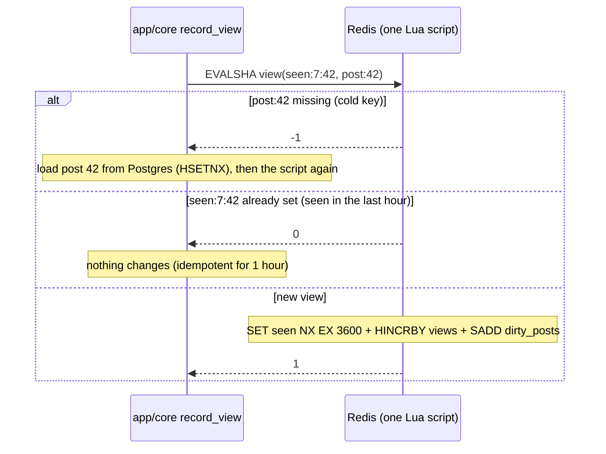

Views do not touch Postgres (only a cold key does). That is why they are fast, and they are 95%
of the traffic.

### Flow 3b: Many views at once (`POST /api/v1/views:batch`, gRPC `RecordViews`)

Code: `record_views()` in `app/core/views.py`, script `VIEW_BATCH_SCRIPT` in `app/core/cache.py`.

The API Gateway collects views for ~50 ms and sends them in one call (1..1000 views).
The script runs the steps of Flow 3 for every view in a loop and returns one code per view.
Cold posts of the whole batch are loaded from Postgres with **one** SQL query, then only those
views go through the script again. Returns `counted` = how many views were new.

Idempotent: every view is deduped by its `seen:` key, so the whole batch may be retried.
Test: `test_batch_retry_after_lost_response_does_not_count_twice`.

### Flow 4: Get counters (`GET /api/v1/counters?post_ids=1,2,3`, gRPC `GetCounters`)

Code: `get_counters()` in `app/core/counters.py`. This pattern is called **cache-aside**.

1. `HMGET post:{id} likes views` for every id, all in **one** Redis pipeline (one round trip).
2. Ids that are missing in Redis (a "miss"): read them from `post_counters` in one SQL query,
   and put them into Redis with `HSETNX`. Posts that are not in Postgres get 0.
3. `liked_by_me`: one SQL query:
   `SELECT post_id FROM likes WHERE user_id = $1 AND post_id = ANY($2)`.
4. Return `[{post_id, likes, views, liked_by_me}, ...]`.

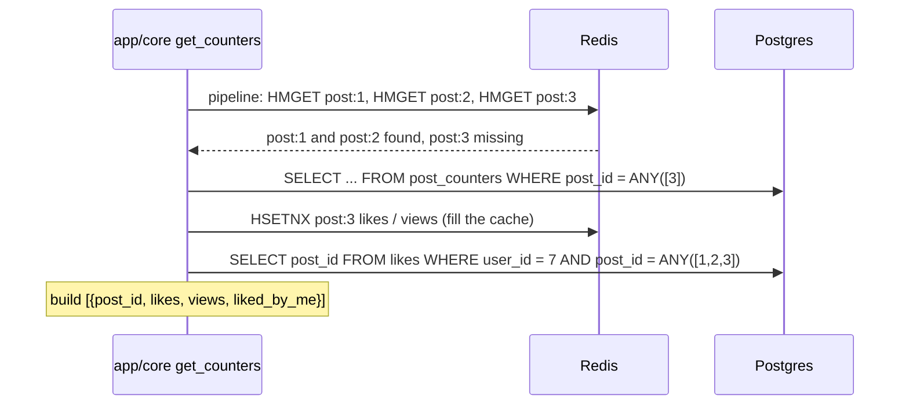

Reads come from Redis, and Redis is updated at once. So a new like is visible in the next read,
well inside the 2 s eventual consistency limit.

### Flow 5: Sync Worker (`python -m app.worker`)

Code: `app/worker/sync.py`. A separate container.

1. Every 5 seconds it wakes up.
2. `SPOP dirty_posts 1000`: takes up to 1000 changed post ids.
3. `HMGET` their counts from Redis (one pipeline).
4. Writes them all to Postgres with **one** SQL statement: the ids, likes and views go as 3
   arrays, `unnest()` turns them into rows:
   `INSERT INTO post_counters SELECT ... FROM unnest($1, $2, $3) ON CONFLICT (post_id) DO UPDATE ...`.
   Rows that did not change are skipped (`WHERE ... IS DISTINCT FROM ...`).
   `SET LOCAL synchronous_commit = off`: `post_counters` is only a copy (Redis has the live
   values), so we do not wait for the WAL flush to disk. Details and numbers: SIS #3.
5. If the write fails, the ids go back into `dirty_posts`, so the next round retries them.
6. Repeats steps 2–4 until `dirty_posts` is empty.
7. On SIGTERM (`docker compose stop`) it does one last sync and stops cleanly.

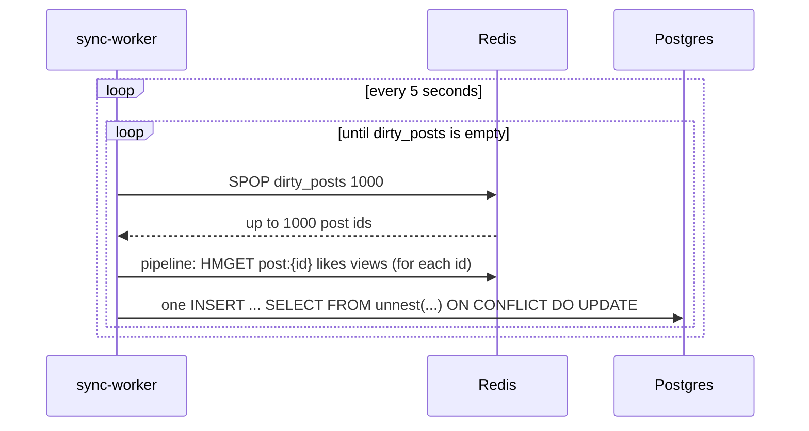

Postgres is at most about 5 s behind Redis. Users do not see this, because they read from Redis.

---

## The parts of the task

### Part 1. The protocol: gRPC

Contract: [proto/counter.proto](proto/counter.proto). Server: [app/grpc_api/server.py](app/grpc_api/server.py).

Why gRPC (from SIS #1):

- **Protobuf is binary and small.** It sends field numbers instead of field names, and numbers
  in a compact form. The GetCounters response for 100 posts: **6,281 B JSON vs 1,098 B Protobuf**.
- **HTTP/2.** Many calls go at the same time over one connection. HTTP/1.1 can send only one
  request at a time per connection, so the client needs many connections.
- **A strict contract.** The `.proto` file says exactly which methods and fields exist.
  Client and server code is generated from it, so they cannot disagree.
- **Built-in deadlines and retries.** We only configure them.

Where to use it: **inside** the system, between the API Gateway and the services. Outside, for
browsers and mobile apps, REST/JSON stays, because everyone understands it.

### Part 2. Idempotency, timeouts, retries

#### Idempotency

**Idempotent** = doing a call 2 times gives the same result as doing it 1 time.

| Operation | Why it is idempotent |
|---|---|
| Like (`PUT`, `LikePost`) | Primary key `(user_id, post_id)` + `ON CONFLICT DO NOTHING`. The second INSERT inserts 0 rows, so the counter does not change. |
| Unlike (`DELETE`, `UnlikePost`) | The second DELETE deletes 0 rows, so the counter does not change. |
| View (`POST`, `RecordView`) | `SET ... NX`: the second SET in the same hour does nothing, so the counter does not change. |
| Many views (`POST /views:batch`, `RecordViews`) | The same `SET ... NX` for every view in the batch. A retried batch counts 0 new views. |
| Get counters (`GET`, `GetCounters`) | It only reads. |

The counter changes **only when the state really changes**. This is what makes retries safe.

**Why this makes retries safe.** Imagine the server saved the like, but the answer was lost on
the network. The client does not know if the like was saved, so it sends it again.
- If like were "+1 every time", we would count 2 likes. That is wrong.
- Our like is idempotent, so the second call changes nothing. We count 1. That is correct.

Test: `test_retry_after_lost_response_does_not_count_twice` makes exactly this happen and
checks that the count is still 1.

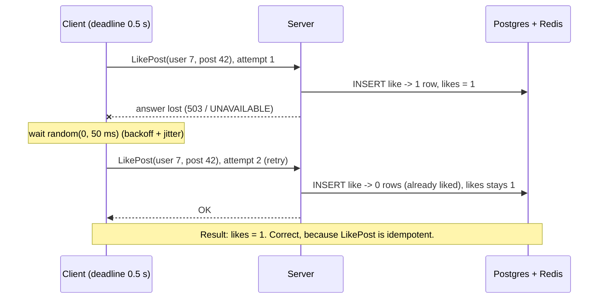

**Why `PUT` and not `PATCH` or `POST` for the like:** a like is a **state** ("liked: yes/no").
`PUT` means "set the state", and HTTP says `PUT` is idempotent. `PATCH` and `POST` are not
idempotent by the HTTP standard. A view is an **event**, so it is `POST`. We make it idempotent
for 1 hour with `SET NX`.

#### Timeouts

There are two layers. The server timeout is shorter than the client deadline, so the server
can answer "try again" while the client still has time to retry.

| Where | Value | What happens |
|---|---|---|
| Client deadline (REST and gRPC) | **0.5 s** for the whole call, retries included | REST: `asyncio.timeout`. gRPC: `timeout=0.5`. After 0.5 s the client stops waiting: `DeadlineExceededError`. |
| Server → Postgres | **200 ms** per SQL command | asyncpg `command_timeout`. Too slow → REST **503**, gRPC **UNAVAILABLE**. |
| Server → Redis | **200 ms** per command | redis-py `socket_timeout`. Too slow → REST **503**, gRPC **UNAVAILABLE**. |

So nothing waits forever. Tests: `test_slow_server_gives_deadline_exceeded_fast`,
`test_*_when_postgres_is_slow`, `test_*_when_redis_is_slow`.

#### Retries

The same rules for both protocols:

- at most **3 attempts** (the first call + 2 retries);
- retry **only** "try again later" answers: gRPC `UNAVAILABLE`; REST `502`, `503`, `504` or a lost connection;
- do **not** retry a bad request (`422` / `INVALID_ARGUMENT`), because a retry will not fix it;
- before each retry, wait a random time: **exponential backoff with full jitter**:
  random(0, 50 ms), then random(0, 100 ms), and never more than random(0, 200 ms);
- **never go past the deadline**: if the wait would cross the 0.5 s deadline, stop.

| | gRPC | REST |
|---|---|---|
| Where | `SERVICE_CONFIG` in [clients/grpc_client.py](clients/grpc_client.py). The gRPC library does the retries. | `send()` in [clients/rest_client.py](clients/rest_client.py). Our own small loop. |
| Which calls | Listed by name in `IDEMPOTENT_METHODS` | All 5 operations (all are idempotent) |

**Why backoff:** if the server is overloaded, instant retries make it worse.
**Why jitter (random):** if 1000 clients fail at the same moment, without jitter they all retry
at the same moment again (a "retry storm"). Random waits spread them out.

#### Fault injection (only for tests, off by default)

To show that timeouts and retries work, the server can break on purpose. Settings
(env vars, all default to 0 / off):

| Env var | Effect |
|---|---|
| `FAULT_FAIL_FIRST_N=2` | The first 2 calls fail with 503 / UNAVAILABLE. |
| `FAULT_FAIL_AFTER_WORK=true` | The call does the work first, then fails ("lost answer"). |
| `FAULT_DELAY_MS=2000` | Every call waits 2 s first ("slow server"). |

Code: [app/core/faults.py](app/core/faults.py). Both protocols use it the same way:
`async with faults.around_call(): ...`.

### Part 3. Measurements

Full results: [benchmark/results.md](benchmark/results.md). Charts:

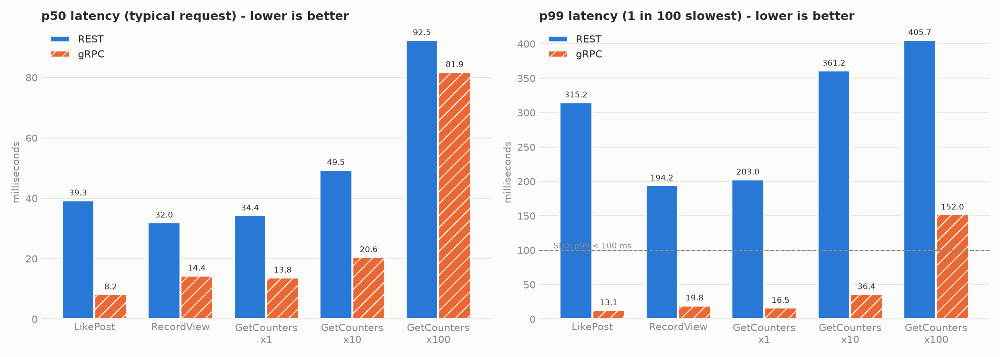

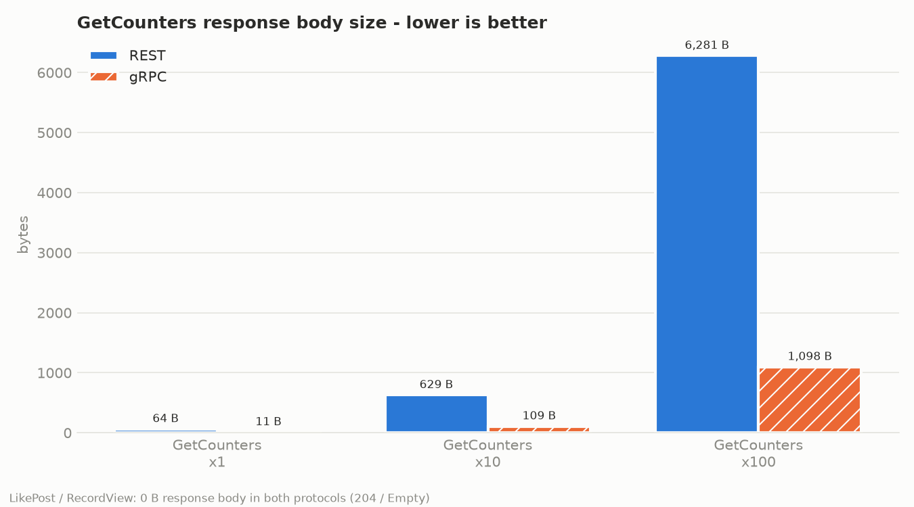

**Setup:** for each operation, 500 warm-up requests, then 10,000 measured requests, 50 at the
same time. Both servers run in 1 process each (`WORKERS=1 docker compose up -d`), with the same
Postgres, Redis and `app/core` code. This test compares the protocols for one call; Part 4 is the
full 20K load.

**What the numbers say:**

- **Payload:** Protobuf requests are **2.2–3.7x smaller** than the same data as JSON. GetCounters
  responses are about **5.7x smaller** for every size.
  JSON repeats the field names (`"post_id"`, `"likes"`, ...) for every post; Protobuf does not.
- **Small, fast calls** (like, view, GetCounters with 1–10 posts): gRPC p50 is
  **2–2.8x lower**, p99 is **8–13x lower**, and throughput is **2.9–3.8x higher**.
  gRPC meets the SIS #1 SLO **p99 < 100 ms** in these 4 operations; REST meets it in none.
- **GetCounters with 100 posts:** the server work (100 Redis reads + 1 SQL query) is most of the
  time, so p50 is almost the same (1.1x). p99 is 4.3x lower, but gRPC just misses the SLO
  (105.5 ms). The payload is still 5.7x smaller.
- REST had 171 calls of 50,000 that hit the 0.5 s deadline (errors column); gRPC had none in this run.

**Be honest about the limits:**

- The client library is part of the result. The REST client (httpx) is pure Python and used a
  full CPU core at 50 parallel requests. The gRPC client is written in C.
- Everything runs on one laptop (Docker Desktop, 8 CPUs), so absolute numbers are small.
  The **ratios** are what matter.
- p99 for GetCounters x100 changes a lot between runs.

**When REST is still fine:** public APIs for browsers and mobile apps, simple tools,
easy debugging with `curl`, and small or rare calls where a few bytes and milliseconds do not matter.

### Part 4. 20K increments/s

Full results: [benchmark/load_results.md](benchmark/load_results.md). Script:
[benchmark/run_load.py](benchmark/run_load.py) (runs k6 with [loadtest/increments.js](loadtest/increments.js)).

**How we measure:** k6 sends requests at a **fixed rate** (open model): new requests come even
if the server is slow, so queueing shows up in p99. The old benchmark (Part 3, "50 at a time")
slows down together with the server and hides that. Workload: 95% views, 5% likes, every
(user, post) pair new; 90% of increments go to 100K hot posts, 10% to any of 50M posts.

**Step 1 — the problem.** One Python process per server reached only **~2,000 RPS**. A profile
(py-spy) showed ~75% of the time in the gRPC / asyncio runtime itself, not in our code. Python
runs one thread of code at a time (the GIL), so one process = one CPU core ≈ 2,000–2,300 calls/s.
20,000 / 2,300 ≈ **9 cores** just for one call per increment — more than the whole laptop has.

**Step 2 — what we changed:**

1. **1 Redis round trip per view** instead of 3 (a Lua script, see "One Redis round trip").
2. **4 processes per server** (`WORKERS`, `SO_REUSEPORT` for gRPC, `uvicorn --workers` for REST).
3. **Batching:** the API Gateway sends views in batches of 100 (`RecordViews`). 20K views/s =
   **200 calls/s** instead of 20,000. Likes stay one by one (a user action that needs an answer).

**Step 3 — the result (60 s at a fixed rate, 4 processes):**

| Protocol | target inc/s | achieved inc/s | failed | batch p50 / p99 ms | like p99 ms | consistency lag p50 / p99 ms |
|---|---:|---:|---:|---:|---:|---:|
| gRPC | 20,000 | **20,001** | 0 | 2.2 / **12.9** | 11.7 | 2 / **15** |
| REST | 20,000 | 20,001 | 0 | 2.5 / 12.3 | 10.7 | 3 / 18 |
| gRPC | 40,000 | 39,780 | 0 | 4.5 / 105.0 | 80.1 | 6 / 137 |
| REST | 40,000 | 39,734 | 1 | 9.6 / 196.2 | 153.5 | 14 / 249 |

- **20K: both protocols keep up** with p99 ≈ 13 ms, far inside the SLO (p99 < 100 ms).
- **Consistency lag** = time from sending a view until a read returns it: p99 **15 ms** vs the
  requirement **≤ 2 s**. Reads come from Redis, which is updated at once.
- **40K (2x headroom):** gRPC degrades less than REST (p99 105 vs 196 ms).
- **Payload of a batch of 100 views:** JSON 4,182 B vs Protobuf **1,293 B (3.2x smaller)**.

**One call per view (no batching)** — the ceiling of the protocols, table 2 in
[benchmark/load_results.md](benchmark/load_results.md): about **1,000–2,000 RPS per process**, and
at most **~5,000–9,000 RPS with 4 processes**, depending on the run. These numbers move a lot
between runs on one laptop (k6, both servers, Redis and Postgres share 8 cores), so use them
only for the conclusion: **without batching, 20K is out of reach on this machine; with batching
it takes ~25% of the gRPC server's CPU.**

**So the most important decision for 20K was batching, then the protocol.** gRPC still wins on
size (3.2x) and on the tail under heavy load.

## AI use

Claude (Anthropic) was used as a working tool: to write and refactor code, tests, load-test
scripts and Docker config, to run the benchmarks, and to draft the docs. The design decisions
(gRPC, batching, Lua scripts, the cold key rule) and every number were checked and explained
by the author; all numbers come from measurements in `benchmark/`.

