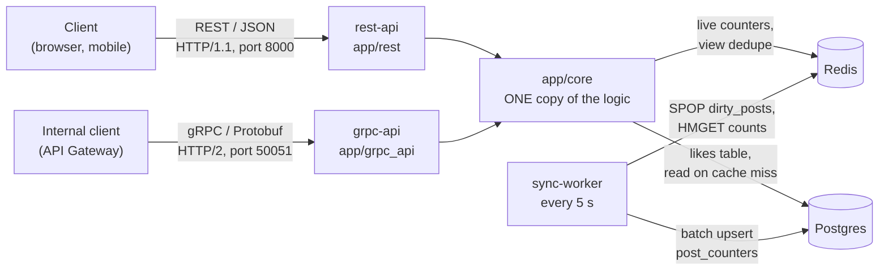
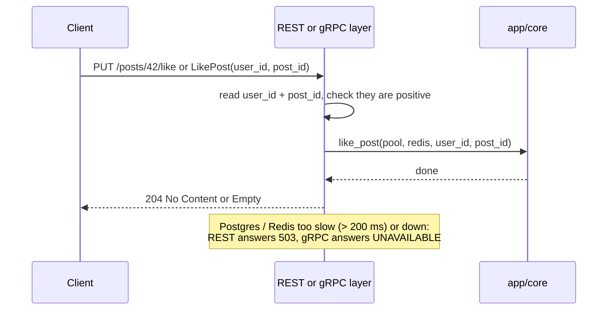
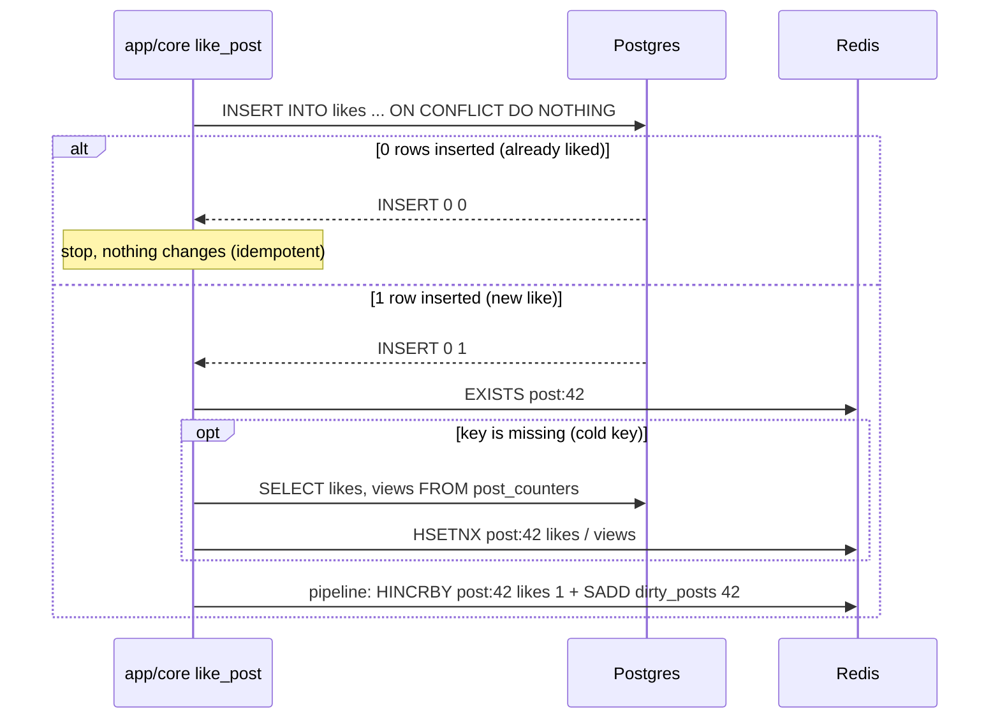
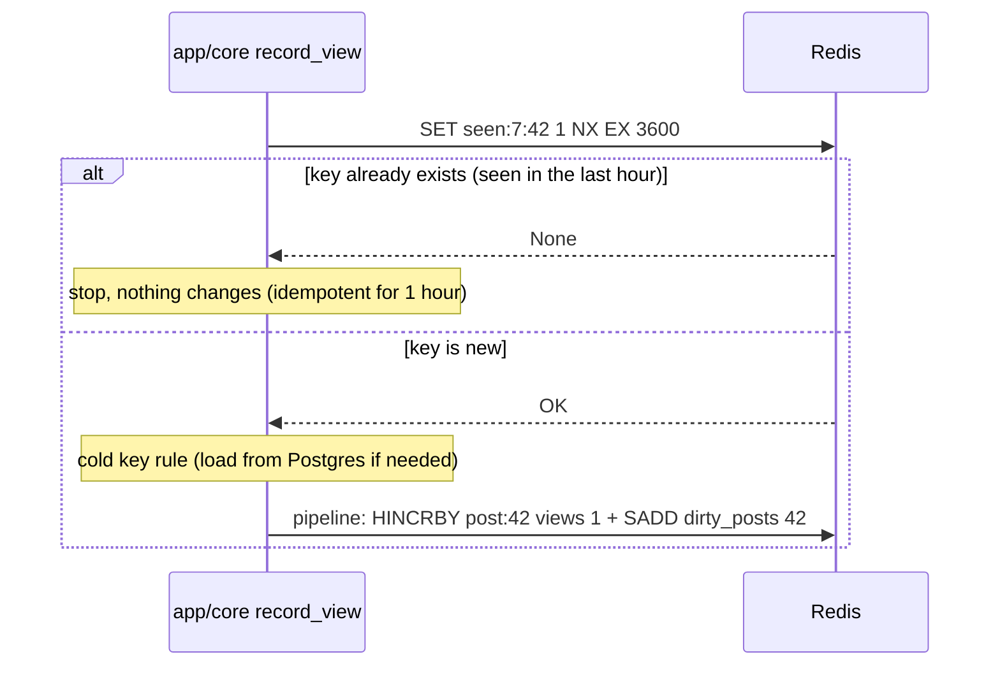
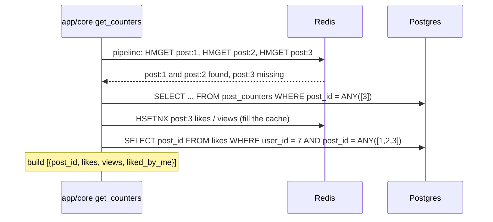
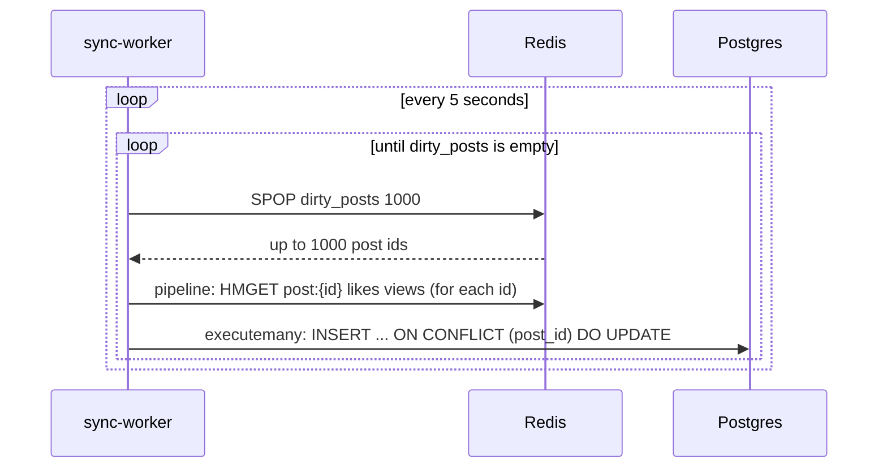
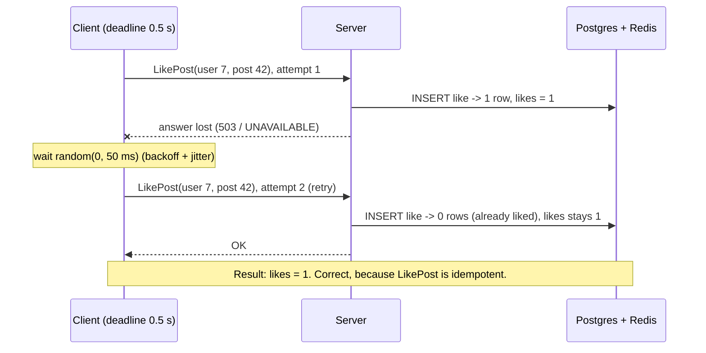
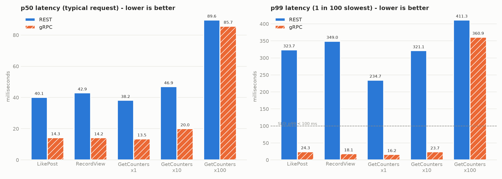
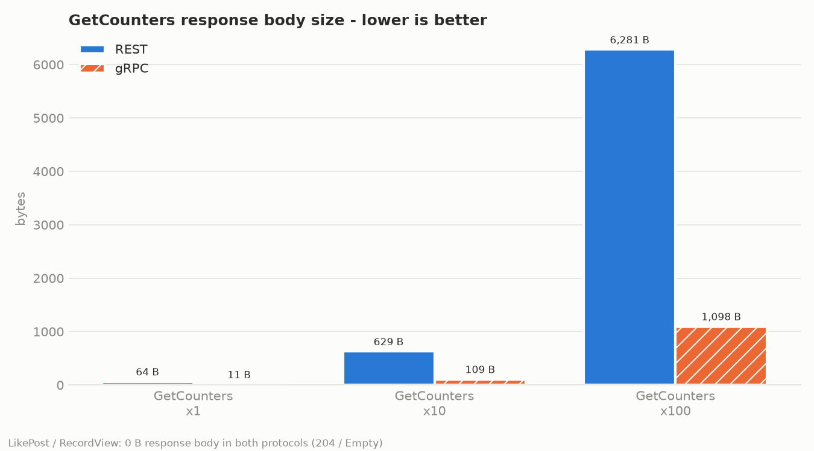

# T7 Like & View Counter — SIS #2: Protocol implementation

Course: Backend for Highloaded Environment.

**The task:** implement the service interface with the protocol from SIS #1 (we chose **gRPC**),
with idempotency, timeouts and retries, and measure latency and payload size against a
REST/JSON baseline.

**Short answer:** gRPC was **2.3–3x faster at p50**, **13–19x faster at p99**,
had **3.4–4.7x more throughput** and sent **5.7–5.8x smaller responses**. One exception:
in GetCounters with 100 posts the server work takes most of the time, so the speed was almost
the same. But the response was still 5.7x smaller.
Details are in [benchmark/results.md](benchmark/results.md).

## Contents

1. [How to run](#how-to-run)
2. [How to run the tests](#how-to-run-the-tests)
3. [How to run the benchmark](#how-to-run-the-benchmark)
4. [Project structure](#project-structure)
5. [How it works](#how-it-works) (like, unlike, view, get counters, sync worker)
6. [The three parts of the task](#the-three-parts-of-the-task) (protocol, idempotency + timeouts + retries, measurements)

---

## How to run

You need Docker.

```bash
docker compose up --build
```

This starts 5 containers:

| Container | What it does | Port |
|---|---|---|
| `postgres` | Database. Stores likes and a saved copy of the counters. | 5432 |
| `redis` | Live counters in memory. Very fast. | 6379 |
| `rest-api` | REST/JSON API (FastAPI + Uvicorn). Runs the migration first. | 8000 |
| `grpc-api` | gRPC API (grpcio). Uses the **same** code as `rest-api`. | 50051 |
| `sync-worker` | Every 5 s copies counters from Redis to Postgres. | – |

Try the REST API:

```bash
curl -X PUT  -H "X-User-Id: 1" http://localhost:8000/api/v1/posts/42/like
curl -X POST -H "X-User-Id: 1" http://localhost:8000/api/v1/posts/42/view
curl -H "X-User-Id: 1" "http://localhost:8000/api/v1/counters?post_ids=42,43"
```

API docs in the browser: http://localhost:8000/docs

Try the gRPC API (from the project folder, with the Python packages installed):

```python
import asyncio
from clients.grpc_client import GrpcCounterClient


async def main():
    async with GrpcCounterClient("localhost:50051") as client:
        await client.like_post(user_id=1, post_id=42)
        print(await client.get_counters(user_id=1, post_ids=[42, 43]))


asyncio.run(main())
```

Stop: `docker compose down` (add `-v` to delete the data too).

## How to run the tests

The tests start real Postgres and Redis in Docker (testcontainers). Docker must be running.

```bash
python3.12 -m venv .venv
source .venv/bin/activate
pip install -r requirements.txt
pytest -v          # 43 tests
make lint          # code style: ruff check + ruff format --check
```

| File | What it tests |
|---|---|
| `tests/test_rest.py` | REST: like, unlike, view, get counters, cache miss, cold key, sync worker |
| `tests/test_grpc.py` | gRPC: the same operations, and **REST and gRPC return the same data** |
| `tests/test_reliability.py` | Idempotency, retries, timeouts — **each test runs twice: REST and gRPC** |

## How to run the benchmark

```bash
docker compose up -d --build
docker compose run --rm benchmark     # or: make bench
```

It takes about 2 minutes. It writes 4 files into `benchmark/`:

- `results.csv` — all numbers;
- `results.md` — tables and notes;
- `latency_p50_p99.png` — latency chart;
- `payload_size.png` — payload size chart.

To redraw the charts from `results.csv`: `python -m benchmark.charts`.

The benchmark runs **inside** the Docker network, next to the servers. Why: on a Mac, Docker
Desktop port forwarding made REST (50 TCP connections) 3–4x slower, but not gRPC
(1 connection). That would not be fair.

## Project structure

```
proto/counter.proto        the gRPC contract (methods and messages)
app/
  config.py                all settings, from env vars
  core/                    THE logic. Used by both REST and gRPC.
    resources.py           creates the Postgres pool and Redis client (with timeouts)
    cache.py               Redis helpers: cold key, cache miss, increment
    likes.py               like_post, unlike_post
    views.py               record_view
    counters.py            get_counters
    errors.py              "backend is slow or down" errors -> 503 / UNAVAILABLE
    faults.py              fault injection for tests (off by default)
  rest/                    REST layer: only translates HTTP/JSON <-> app/core
  grpc_api/                gRPC layer: only translates Protobuf <-> app/core
    generated/             code generated from the .proto file (do not edit)
  worker/                  Sync Worker
clients/                   REST and gRPC clients with deadline + retries
benchmark/                 benchmark script, results, charts
tests/                     integration tests
migrations/                Alembic (creates the tables)
```

**Why the folder is `grpc_api` and not `grpc`:** a folder named `grpc` would hide the
`grpc` library, and `import grpc` would break.

**About `app/grpc_api/generated/`:** these files are made by a tool (`protoc`) from
`proto/counter.proto`. Strange names like `app_dot_grpc__api_dot_generated_dot_counter__pb2`
come from the tool. We never edit these files by hand. After changing the `.proto` file, run:

```bash
make proto
```

## How it works

### Architecture



The main idea: **there is only one copy of the logic** (`app/core`). REST and gRPC are thin
"translators" on top of it. So in the benchmark, the only difference is the protocol.

### One request through the layers



### Where the data lives

- **Postgres `likes(user_id, post_id, created_at)`**: who liked what.
  The primary key `(user_id, post_id)` makes sure one user can like a post only once.
- **Postgres `post_counters(post_id, likes, views, updated_at)`**: a safe copy of the counters on disk.
- **Redis `post:{post_id}`**: a hash `{likes, views}`. The live counter. No TTL.
- **Redis `seen:{user_id}:{post_id}`**: `"1"` with TTL 1 hour. It dedupes views.
- **Redis `dirty_posts`**: a set of posts that changed since the last sync.

### The "cold key" rule

Sometimes `post:{id}` is not in Redis, for example after a Redis restart. If we just add +1,
the counter starts from 0, which is wrong. So before every +1 or −1:

1. Check if `post:{id}` exists in Redis.
2. If not, read the counts from `post_counters` in Postgres.
3. Put them into Redis with `HSETNX`. It writes a field only if it is empty, so it never
   overwrites a newer value.

Code: `ensure_loaded()` in `app/core/cache.py`.

### Flow 1: Like (`PUT /api/v1/posts/{id}/like`, gRPC `LikePost`)

Code: `like_post()` in `app/core/likes.py`.

1. `INSERT INTO likes ... ON CONFLICT DO NOTHING`.
2. Postgres says how many rows were inserted: `"INSERT 0 1"` or `"INSERT 0 0"`.
3. 0 rows: the user already liked this post. Stop. Nothing changes.
4. 1 row: apply the cold key rule.
5. In one Redis pipeline: `HINCRBY post:{id} likes 1` and `SADD dirty_posts {id}`.



### Flow 2: Unlike (`DELETE /api/v1/posts/{id}/like`, gRPC `UnlikePost`)

Code: `unlike_post()` in `app/core/likes.py`.

1. `DELETE FROM likes WHERE user_id = ... AND post_id = ...`.
2. 0 rows deleted: the user did not like this post. Stop.
3. 1 row deleted: cold key rule, then `HINCRBY likes -1` and `SADD dirty_posts`.

### Flow 3: View (`POST /api/v1/posts/{id}/view`, gRPC `RecordView`)

Code: `record_view()` in `app/core/views.py`.

1. `SET seen:{user}:{post} 1 NX EX 3600`.
   `NX` = only if the key does not exist. `EX 3600` = delete it after 1 hour.
2. Redis says nothing (None): this user saw this post in the last hour. Stop.
3. Redis says OK: a new view. Cold key rule, then `HINCRBY views 1` and `SADD dirty_posts`.



Views never touch Postgres. That is why they are fast, and they are 95% of the traffic.

### Flow 4: Get counters (`GET /api/v1/counters?post_ids=1,2,3`, gRPC `GetCounters`)

Code: `get_counters()` in `app/core/counters.py`. This pattern is called **cache-aside**.

1. `HMGET post:{id} likes views` for every id, all in **one** Redis pipeline (one round trip).
2. Ids that are missing in Redis (a "miss"): read them from `post_counters` in one SQL query,
   and put them into Redis with `HSETNX`. Posts that are not in Postgres get 0.
3. `liked_by_me`: one SQL query:
   `SELECT post_id FROM likes WHERE user_id = $1 AND post_id = ANY($2)`.
4. Return `[{post_id, likes, views, liked_by_me}, ...]`.



Reads come from Redis, and Redis is updated at once. So a new like is visible in the next read,
well inside the 2 s eventual consistency limit.

### Flow 5: Sync Worker (`python -m app.worker`)

Code: `app/worker/sync.py`. A separate container.

1. Every 5 seconds it wakes up.
2. `SPOP dirty_posts 1000`: takes up to 1000 changed post ids.
3. `HMGET` their counts from Redis (one pipeline).
4. Writes them all to Postgres in one batch (`executemany`):
   `INSERT INTO post_counters ... ON CONFLICT (post_id) DO UPDATE SET likes = ..., views = ...`.
5. Repeats steps 2–4 until `dirty_posts` is empty.
6. On SIGTERM (`docker compose stop`) it does one last sync and stops cleanly.



Postgres is at most about 5 s behind Redis. Users do not see this, because they read from Redis.

---

## The three parts of the task

### Part 1. The protocol: gRPC

Contract: [proto/counter.proto](proto/counter.proto). Server: [app/grpc_api/server.py](app/grpc_api/server.py).

Why gRPC (from SIS #1):

- **Protobuf is binary and small.** It sends field numbers instead of field names, and numbers
  in a compact form. The GetCounters response for 100 posts: **6,281 B JSON vs 1,098 B Protobuf**.
- **HTTP/2.** Many calls go at the same time over one connection. HTTP/1.1 can send only one
  request at a time per connection, so the client needs many connections.
- **A strict contract.** The `.proto` file says exactly which methods and fields exist.
  Client and server code is generated from it, so they cannot disagree.
- **Built-in deadlines and retries.** We only configure them.

Where to use it: **inside** the system, between the API Gateway and the services. Outside, for
browsers and mobile apps, REST/JSON stays, because everyone understands it.

### Part 2. Idempotency, timeouts, retries

#### Idempotency

**Idempotent** = doing a call 2 times gives the same result as doing it 1 time.

| Operation | Why it is idempotent |
|---|---|
| Like (`PUT`, `LikePost`) | Primary key `(user_id, post_id)` + `ON CONFLICT DO NOTHING`. The second INSERT inserts 0 rows, so the counter does not change. |
| Unlike (`DELETE`, `UnlikePost`) | The second DELETE deletes 0 rows, so the counter does not change. |
| View (`POST`, `RecordView`) | `SET ... NX`: the second SET in the same hour does nothing, so the counter does not change. |
| Get counters (`GET`, `GetCounters`) | It only reads. |

The counter changes **only when the state really changes**. This is what makes retries safe.

**Why this makes retries safe.** Imagine the server saved the like, but the answer was lost on
the network. The client does not know if the like was saved, so it sends it again.
- If like were "+1 every time", we would count 2 likes. That is wrong.
- Our like is idempotent, so the second call changes nothing. We count 1. That is correct.

Test: `test_retry_after_lost_response_does_not_count_twice` makes exactly this happen and
checks that the count is still 1.



**Why `PUT` and not `PATCH` or `POST` for the like:** a like is a **state** ("liked: yes/no").
`PUT` means "set the state", and HTTP says `PUT` is idempotent. `PATCH` and `POST` are not
idempotent by the HTTP standard. A view is an **event**, so it is `POST`. We make it idempotent
for 1 hour with `SET NX`.

#### Timeouts

There are two layers. The server timeout is shorter than the client deadline, so the server
can answer "try again" while the client still has time to retry.

| Where | Value | What happens |
|---|---|---|
| Client deadline (REST and gRPC) | **0.5 s** for the whole call, retries included | REST: `asyncio.timeout`. gRPC: `timeout=0.5`. After 0.5 s the client stops waiting: `DeadlineExceededError`. |
| Server → Postgres | **200 ms** per SQL command | asyncpg `command_timeout`. Too slow → REST **503**, gRPC **UNAVAILABLE**. |
| Server → Redis | **200 ms** per command | redis-py `socket_timeout`. Too slow → REST **503**, gRPC **UNAVAILABLE**. |

So nothing waits forever. Tests: `test_slow_server_gives_deadline_exceeded_fast`,
`test_*_when_postgres_is_slow`, `test_*_when_redis_is_slow`.

#### Retries

The same rules for both protocols:

- at most **3 attempts** (the first call + 2 retries);
- retry **only** "try again later" answers: gRPC `UNAVAILABLE`; REST `502`, `503`, `504` or a lost connection;
- do **not** retry a bad request (`422` / `INVALID_ARGUMENT`), because a retry will not fix it;
- before each retry, wait a random time: **exponential backoff with full jitter**:
  random(0, 50 ms), then random(0, 100 ms), and never more than random(0, 200 ms);
- **never go past the deadline**: if the wait would cross the 0.5 s deadline, stop.

| | gRPC | REST |
|---|---|---|
| Where | `SERVICE_CONFIG` in [clients/grpc_client.py](clients/grpc_client.py). The gRPC library does the retries. | `send()` in [clients/rest_client.py](clients/rest_client.py). Our own small loop. |
| Which calls | Listed by name in `IDEMPOTENT_METHODS` | All 4 operations (all are idempotent) |

**Why backoff:** if the server is overloaded, instant retries make it worse.
**Why jitter (random):** if 1000 clients fail at the same moment, without jitter they all retry
at the same moment again (a "retry storm"). Random waits spread them out.

#### Fault injection (only for tests, off by default)

To show that timeouts and retries work, the server can break on purpose. Settings
(env vars, all default to 0 / off):

| Env var | Effect |
|---|---|
| `FAULT_FAIL_FIRST_N=2` | The first 2 calls fail with 503 / UNAVAILABLE. |
| `FAULT_FAIL_AFTER_WORK=true` | The call does the work first, then fails ("lost answer"). |
| `FAULT_DELAY_MS=2000` | Every call waits 2 s first ("slow server"). |

Code: [app/core/faults.py](app/core/faults.py). Both protocols use it the same way:
`async with faults.around_call(): ...`.

### Part 3. Measurements

Full results: [benchmark/results.md](benchmark/results.md). Charts:





**Setup:** for each operation, 500 warm-up requests, then 10,000 measured requests, 50 at the
same time. Both servers run in 1 process each, with the same Postgres, Redis and `app/core` code.

**What the numbers say:**

- **Payload:** Protobuf is about **5.7x smaller** than JSON for every GetCounters size.
  JSON repeats the field names (`"post_id"`, `"likes"`, ...) for every post; Protobuf does not.
- **Small, fast calls** (like, view, GetCounters with 1–10 posts): gRPC p50 is
  **2.3–3x lower**, p99 is **13–19x lower**, and throughput is **3.4–4.7x higher**.
  gRPC meets the SIS #1 SLO **p99 < 100 ms**; REST does not at this load.
- **GetCounters with 100 posts:** the server work (100 Redis reads + 1 SQL query) is most of the
  time, so latency is about the same. The payload is still 5.7x smaller.
- REST had some calls that hit the 0.5 s deadline (errors column); gRPC had almost none.

**Be honest about the limits:**

- The client library is part of the result. The REST client (httpx) is pure Python and used a
  full CPU core at 50 parallel requests. The gRPC client is written in C.
- Everything runs on one laptop (Docker Desktop, 8 CPUs), so absolute numbers are small.
  The **ratios** are what matter.
- p99 for GetCounters x100 changes a lot between runs.

**When REST is still fine:** public APIs for browsers and mobile apps, simple tools,
easy debugging with `curl`, and small or rare calls where a few bytes and milliseconds do not matter.
