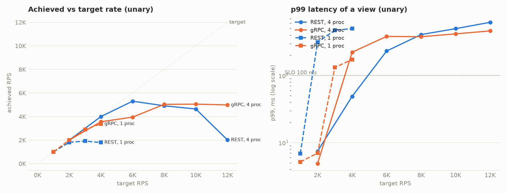

# Load test: 20K increments/s (k6, fixed rate)

- Date: 2026-11-27 16:46
- Machine: arm64, Docker VM with 8 CPUs / 4 GB RAM. Everything on one laptop: k6, both servers, Redis, Postgres.
- Tool: k6 `constant-arrival-rate` (open model): requests arrive at a fixed rate even when the server is slow, so queueing shows up in the latency.
- Workload: 95% views, 5% likes, every (user, post) pair new. 90% of the increments go to 100K hot posts, 10% to any of 50M posts (cold keys -> Postgres reads).
- Kept up = at least 99% of the target rate, under 0.1% failed calls, p99 < 100 ms (SLO).

## 1. Batched views: the requirement (20K increments/s)

Views go in batches of 100 (`RecordViews`), likes one by one (`LikePost`).

| Protocol | target inc/s | achieved inc/s | calls/s | failed | batch p50 ms | batch p99 ms | like p99 ms | consistency lag p50 / p99 ms | kept up |
|---|---:|---:|---:|---:|---:|---:|---:|---:|:---:|
| gRPC | 20,000 | 20,001 | 1,190 | 0 | 2.2 | 12.9 | 11.7 | 2 / 15 | yes |
| REST | 20,000 | 20,001 | 1,190 | 0 | 2.5 | 12.3 | 10.7 | 3 / 18 | yes |
| gRPC | 40,000 | 39,780 | 2,380 | 0 | 4.5 | 105.0 | 80.1 | 6 / 137 | NO |
| REST | 40,000 | 39,734 | 2,380 | 1 | 9.6 | 196.2 | 153.5 | 14 / 249 | NO |

Payload of one batch of 100 views: JSON 4,182 B, Protobuf 1,293 B (3.2x smaller).

## 2. One view per call (unary): the ceiling of each protocol

| Protocol | processes | target RPS | achieved RPS | failed | dropped | view p50 ms | view p99 ms | kept up |
|---|---:|---:|---:|---:|---:|---:|---:|:---:|
| gRPC | 1 | 1,000 | 1,000 | 0 | 8 | 0.8 | 5.2 | yes |
| gRPC | 1 | 2,000 | 2,000 | 0 | 0 | 0.8 | 7.0 | yes |
| gRPC | 1 | 3,000 | 2,898 | 0 | 3,052 | 0.9 | 132.3 | NO |
| gRPC | 1 | 4,000 | 3,380 | 0 | 18,614 | 108.9 | 173.7 | NO |
| REST | 1 | 1,000 | 1,000 | 0 | 0 | 0.9 | 6.9 | yes |
| REST | 1 | 2,000 | 1,811 | 36 | 5,620 | 37.3 | 315.3 | NO |
| REST | 1 | 3,000 | 1,911 | 365 | 32,303 | 160.5 | 473.4 | NO |
| REST | 1 | 4,000 | 1,793 | 2096 | 64,107 | 237.7 | 500.7 | NO |
| gRPC | 4 | 2,000 | 2,000 | 0 | 0 | 0.8 | 4.9 | yes |
| gRPC | 4 | 4,000 | 3,555 | 0 | 13,312 | 39.3 | 222.9 | NO |
| gRPC | 4 | 6,000 | 3,948 | 113 | 62,598 | 128.1 | 383.6 | NO |
| gRPC | 4 | 8,000 | 5,033 | 198 | 88,795 | 135.0 | 379.4 | NO |
| gRPC | 4 | 10,000 | 5,051 | 576 | 147,882 | 186.6 | 418.3 | NO |
| gRPC | 4 | 12,000 | 4,986 | 1469 | 208,959 | 229.3 | 463.2 | NO |
| REST | 4 | 2,000 | 2,000 | 0 | 0 | 1.0 | 7.5 | yes |
| REST | 4 | 4,000 | 3,996 | 0 | 113 | 1.5 | 48.9 | yes |
| REST | 4 | 6,000 | 5,300 | 6 | 20,991 | 90.3 | 232.2 | NO |
| REST | 4 | 8,000 | 4,912 | 546 | 92,116 | 155.6 | 408.4 | NO |
| REST | 4 | 10,000 | 4,637 | 3044 | 157,848 | 205.4 | 500.5 | NO |
| REST | 4 | 12,000 | 2,009 | 53115 | 246,626 | 199.4 | 621.8 | NO |

Highest rate that each setup kept up with:

| Protocol | processes | max kept-up RPS | per process |
|---|---:|---:|---:|
| REST | 1 | 1,000 | 1,000 |
| gRPC | 1 | 2,000 | 2,000 |
| REST | 4 | 4,000 | 1,000 |
| gRPC | 4 | 2,000 | 500 |

