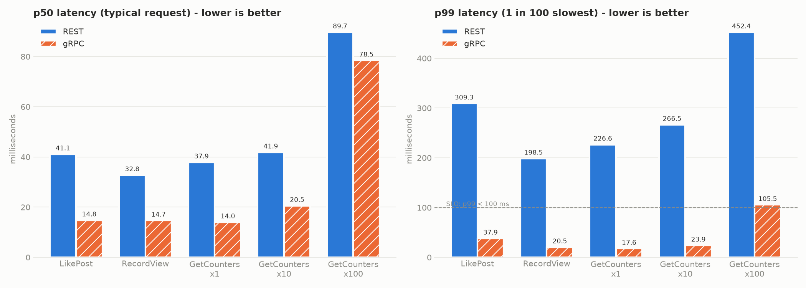
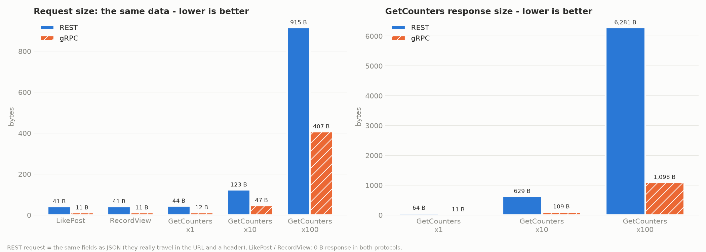

# Benchmark results: REST/JSON vs gRPC

- Date: 2026-10-31 02:48
- Machine: Linux-7.0.14-linuxkit-aarch64-with-glibc2.41, aarch64, Python 3.12.16
- Load: 500 warm-up + 10000 measured requests per operation, concurrency 50
- Servers: `docker compose` (rest-api: 1 Uvicorn process, grpc-api: 1 process), same Postgres + Redis, same `app/core` code
- Clients: `clients/rest_client.py` (httpx, HTTP/1.1 keep-alive) and `clients/grpc_client.py` (grpcio, HTTP/2), both with deadline 0.5 s + retries

## All numbers

| Protocol | Operation | p50 ms | p95 ms | p99 ms | mean ms | RPS | errors | request B | response B |
|---|---|---:|---:|---:|---:|---:|---:|---:|---:|
| REST | LikePost | 41.1 | 178.97 | 309.26 | 60.64 | 812.0 | 15 | 41 | 0 |
| gRPC | LikePost | 14.78 | 20.63 | 37.93 | 16.04 | 3109.7 | 0 | 11 | 0 |
| REST | RecordView | 32.8 | 128.76 | 198.47 | 45.84 | 1088.4 | 0 | 41 | 0 |
| gRPC | RecordView | 14.68 | 16.85 | 20.48 | 14.85 | 3359.5 | 0 | 11 | 0 |
| REST | GetCounters x1 | 37.88 | 146.66 | 226.57 | 52.5 | 949.6 | 1 | 44 | 64 |
| gRPC | GetCounters x1 | 14.02 | 15.41 | 17.55 | 14.07 | 3545.8 | 0 | 12 | 11 |
| REST | GetCounters x10 | 41.85 | 173.47 | 266.49 | 59.66 | 834.2 | 3 | 123 | 629 |
| gRPC | GetCounters x10 | 20.54 | 22.01 | 23.9 | 20.66 | 2414.6 | 0 | 47 | 109 |
| REST | GetCounters x100 | 89.71 | 342.92 | 452.39 | 122.91 | 381.6 | 152 | 915 | 6281 |
| gRPC | GetCounters x100 | 78.45 | 86.76 | 105.51 | 79.64 | 626.4 | 0 | 407 | 1098 |

## gRPC compared to REST

How many times gRPC is better (bigger = better for gRPC; below 1.0x = REST is better).

| Operation | p50 faster | p99 faster | more RPS | request smaller | response smaller | REST p99 < 100 ms | gRPC p99 < 100 ms |
|---|---:|---:|---:|---:|---:|:---:|:---:|
| LikePost | 2.8x | 8.2x | 3.8x | 3.7x | - | NO | yes |
| RecordView | 2.2x | 9.7x | 3.1x | 3.7x | - | NO | yes |
| GetCounters x1 | 2.7x | 12.9x | 3.7x | 3.7x | 5.8x | NO | yes |
| GetCounters x10 | 2.0x | 11.2x | 2.9x | 2.6x | 5.8x | NO | yes |
| GetCounters x100 | 1.1x | 4.3x | 1.6x | 2.2x | 5.7x | NO | NO |

## Conclusion

- **Smaller:** Protobuf requests are 2.2-3.7x smaller than the same data as JSON, and GetCounters responses are 5.7-5.8x smaller.
- **Faster for small calls** (like, view, GetCounters x1 and x10): gRPC p50 is 2.0-2.8x lower, p99 is 8.2-12.9x lower, throughput is 2.9-3.8x higher.
- **GetCounters x100:** p50 1.1x, p99 4.3x, throughput 1.6x. The speed gain is much smaller here, because the server work takes most of the time.
- **SLO p99 < 100 ms:** REST meets it in 0 of 5 operations, gRPC in 4 of 5, on one process and this load.
- **Why smaller:** JSON repeats field names and writes numbers as text. Protobuf sends field numbers and compact numbers.
- **Why faster:** the server logic is the same code. The difference comes from the rest: JSON vs Protobuf work, HTTP/1.1 with 50 connections vs HTTP/2 with one, and a Python vs C client.
- **When REST is still fine:** public APIs for browsers and mobile apps, easy debugging with curl, and small or rare calls, where a few bytes or a millisecond do not matter.

## Notes

- Payload = the same data as JSON bytes vs Protobuf `SerializeToString()` bytes. The REST request data really travels in the URL and the `X-User-Id` header, so `request B` for REST is the size of the same fields written as JSON. HTTP and gRPC headers are not counted. LikePost and RecordView answer 204 / Empty, so their response is 0 bytes in both protocols.
- The biggest size difference is in GetCounters: JSON repeats the field names (`"post_id"`, `"likes"`, ...) for every post; Protobuf sends small field numbers and compact numbers (varints).
- GetCounters x100: here the server work (100 Redis reads + 1 SQL query) is most of the time, so the two protocols are close, and its p99 changes a lot from run to run.
- errors = calls that did not finish inside the client deadline (0.5 s, all retries included). They are counted, but not included in the latency numbers.
- The benchmark runs as a container in the same Docker network as the servers. On a Mac, going through Docker Desktop port forwarding made REST (50 TCP connections) 3-4x slower, but not gRPC (1 HTTP/2 connection), so that would not be a fair test.
- Latency includes the client library. httpx is written in Python; the gRPC client is written in C. At concurrency 50 the httpx client uses a full CPU core, which is a big part of the REST tail latency (p99). This is part of the real cost of each protocol in Python.

